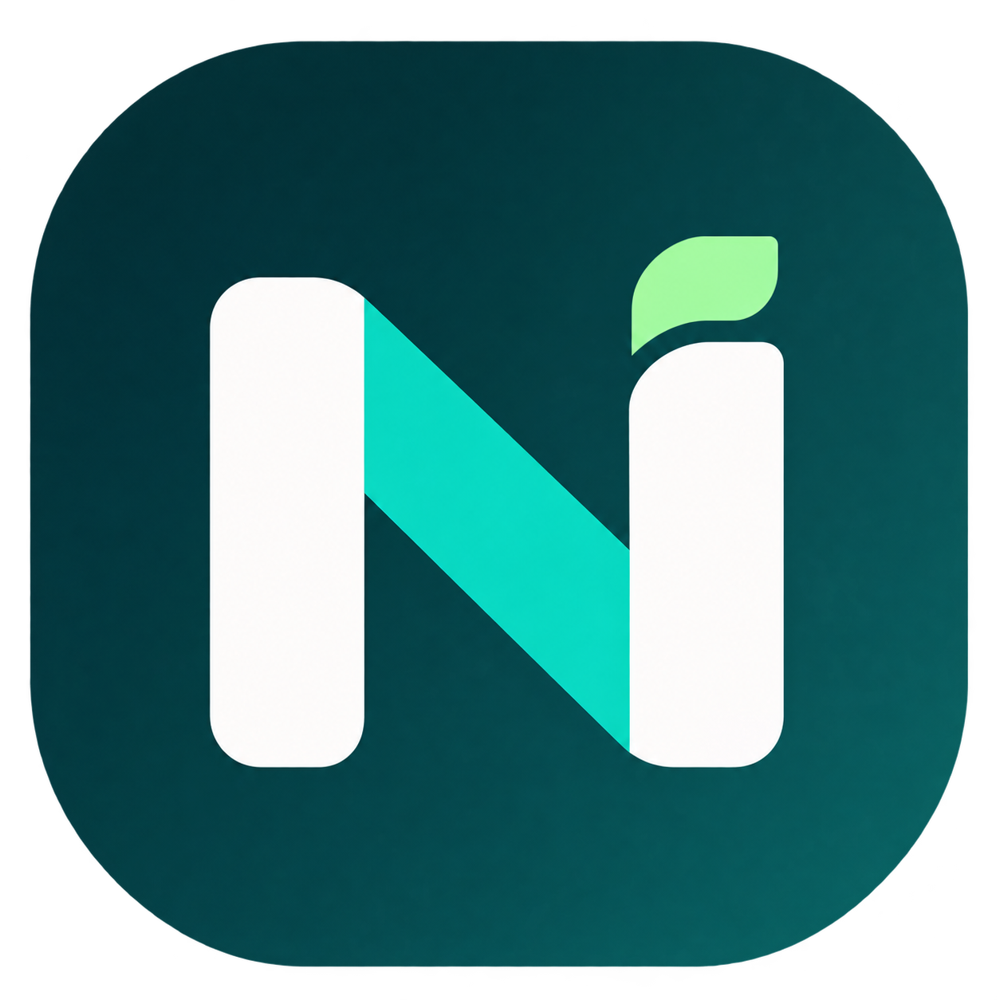
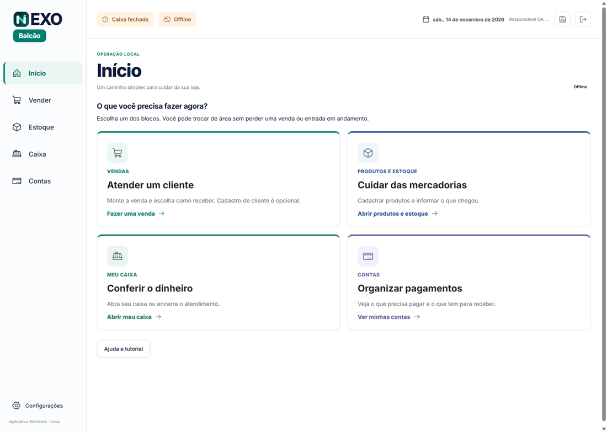
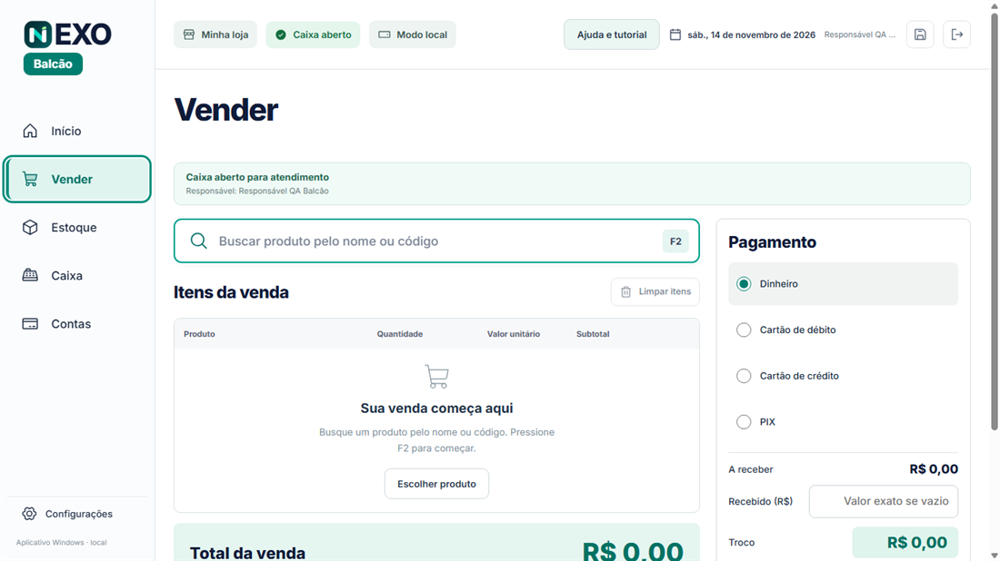
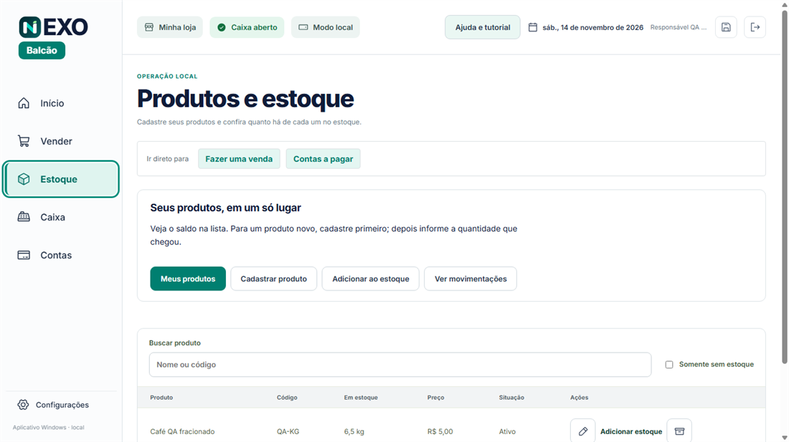
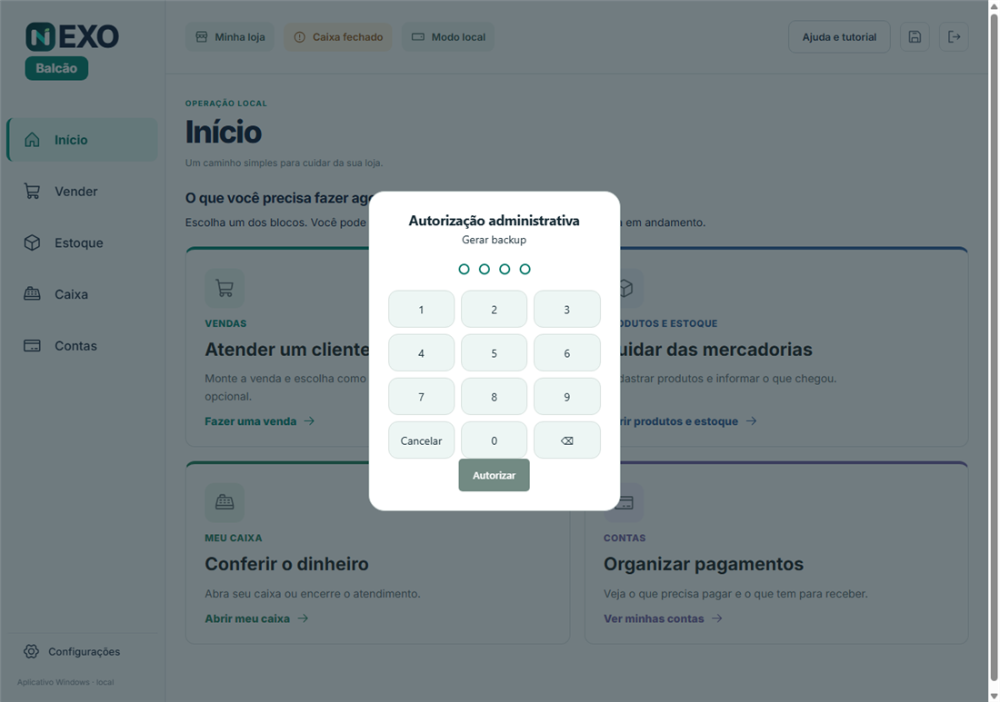

# NEXO Balcão

Gestão comercial para lojas que precisam vender, controlar estoque, operar o caixa e acompanhar contas em um computador Windows. As rotinas de balcão funcionam offline, com os dados no próprio computador.

[Baixar versão pública 1.0.4](https://github.com/EduT3/nexo-gestao-comercial/releases/tag/v1.0.4) · [Ver demonstração](https://nexo-gestao-comercial.vercel.app) · [Compatibilidade Windows](docs/WINDOWS-COMPATIBILITY.md)

## Capturas e demonstração

Capturas do aplicativo Windows em testes com dados fictícios. A tela inicial mostra a versão de origem. Vendas, estoque e Guard mostram a candidata M2. A demonstração web usa dados fictícios e bloqueia gravações. [Execução Windows e evidências](https://github.com/EduT3/nexo-gestao-comercial/actions/runs/43650469127)



<details>
<summary>Frente de vendas</summary>



</details>

<details>
<summary>Produtos e estoque</summary>



</details>

<details>
<summary>NEXO Guard</summary>



</details>

## Funcionalidades

- **Vendas e caixa.** Dinheiro, Pix, débito, crédito, descontos, troco e histórico. Controle de abertura, suprimento, sangria, fechamento e estornos.
- **Produtos e estoque.** Catálogo, compras, entradas, quantidades fracionárias, saldos e histórico de movimentações.
- **Contas.** Pagar, receber e resumo financeiro. Cadastros de clientes e fornecedores disponíveis conforme a operação.
- **Planilhas e recuperação.** Importação de produtos com prévia, exportação Excel e backup restaurável.
- **Operação guiada.** Perfis de responsável e operador, permissões verificadas no aplicativo e tutorial integrado. A candidata M2 inclui uma prática com dados fictícios.

A galeria mostra etapas do desenvolvimento. Consulte as notas de cada versão para confirmar os recursos da sua instalação. [Versão pública](docs/WINDOWS-1.0.4.md) · [Evolução M2](docs/EVOLUCAO-M2.md)

## NEXO Guard

Na candidata M2, o Guard é opcional e começa desativado. O responsável pode exigir um PIN de quatro dígitos para autorizar ações administrativas selecionadas. A escolha por nome identifica quem registra a operação. Qualquer pessoa com acesso à tela de entrada pode escolher os nomes disponíveis. O PIN acrescenta autorização operacional e tem alcance limitado diante de acesso aos arquivos ou de controle do Windows.

Preserve `guard.json` ao migrar de computador e guarde a **chave de recuperação separadamente**, em local seguro. A cópia SQLite gerada pelo aplicativo cobre a base comercial. [Configuração, recuperação e limites](docs/NEXO-GUARD.md)

## Download e instalação

| Opção | Uso |
| --- | --- |
| **Instalador público 1.0.4** | Baixe `NEXO-Setup-1.0.4.exe` na [release pública](https://github.com/EduT3/nexo-gestao-comercial/releases/tag/v1.0.4). Abra o NEXO e cadastre o responsável no primeiro acesso. O instalador está sem assinatura digital. |
| **Candidata M2 1.0.13** | [Artefato temporário do GitHub Actions](https://github.com/EduT3/nexo-gestao-comercial/actions/runs/43797179333/artifacts/14195233556), para perfil isolado e dados fictícios. O ZIP contém o instalador de teste em `installer/`, o manifesto e os relatórios. |
| **ZIP portátil** | Extraia a pasta completa e execute `NEXO.exe` diretamente. A cópia portátil usa atualização manual. Para migrar de um perfil portátil separado, gere o backup nele e restaure pelo programa instalado. |

O banco da instalação padrão fica em `%LOCALAPPDATA%\NEXO\nexo.sqlite`. Veja as evidências do ambiente e da versão antes de adotar o NEXO em uma estação comercial. [Compatibilidade e instalação por sistema](docs/WINDOWS-COMPATIBILITY.md)

## Atualizações e backup

No programa instalado, abra **Configurações → Verificar atualização**. O aplicativo consulta o GitHub Releases, oferece download quando há uma versão disponível e pede confirmação para reiniciar. O fluxo cria uma cópia SQLite antes de instalar. A versão pública 1.0.4 foi consultada e baixada por HTTPS em teste. No Windows Server 2025, a candidata 1.0.13 foi instalada por atualização em canal isolado a partir da 1.0.4 e da 1.0.5 de teste com Guard, preservando os dados fictícios. A atualização em Windows cliente ainda aguarda bancada. [Evidências do atualizador](docs/UPDATE-QA-M2.6.md)

Use **Gerar backup** e guarde a cópia em outro dispositivo. A restauração preserva uma cópia anterior à troca. A planilha Excel serve para consulta e intercâmbio. Use o backup SQLite para recuperação da base e preserve a política do Guard e sua chave conforme a seção anterior.

## Desempenho e requisitos

Em uma base fictícia de 50 mil produtos, 50 mil vendas e 100 mil movimentos, a mediana da consulta de histórico de estoque passou de **109,44 ms para 58,78 ms** no ensaio de otimização. As medições foram feitas com Ryzen 7 7700X e 32 GB de RAM, sem tempo de renderização. [Auditoria Windows](docs/AUDITORIA-WINDOWS.md) · [Comparação SQLite M2](docs/benchmarks/catalogo-m2.json)

No Windows 11, com o mesmo banco fictício de 1.000 produtos e 11 vendas, a mediana até a primeira resposta foi de **387,71 ms na 1.0.6** e **385,90 ms na 1.0.11**. A memória residente dos processos principal e de interface ficou em 212,96 e 212,26 MiB. O ensaio usou executáveis extraídos e janela oculta. [Resultados e limites do M2](docs/EVOLUCAO-M2.md)

| Ambiente | Estado |
| --- | --- |
| Windows 10 22H2 x64 | Homologação pendente. O suporte regular da Microsoft terminou em 14/10/2025. Sem atualizações de segurança, o risco de exploração aumenta. |
| Windows 11 x64 | **Validação manual informada pelo usuário** nos testes práticos que realizou. Em perfil fictício no Windows build 26300.9974, a 1.0.6 extraída passou no roteiro comercial e a 1.0.11 extraída passou em testes dirigidos de venda e navegação. Instalação NSIS e atualização em bancada cliente seguem pendentes. |
| Windows Server 2025 x64 | Na integração contínua, a candidata 1.0.13 passou em 246 testes automatizados e em dois roteiros no aplicativo instalado. |
| Windows 7 | Fora do suporte. A versão moderna do Electron usada pelo NEXO requer Windows 10 ou posterior. |
| Hardware | Mínimo do NEXO ainda sem medição. Quatro núcleos, 8 GB de RAM e SSD são referência para o próximo ensaio, sem homologação. |

[Procedimento e matriz Windows](docs/WINDOWS-COMPATIBILITY.md) · [Ciclo de suporte do Windows 10](https://learn.microsoft.com/windows/release-health/release-information) · [Requisitos do Windows 11](https://support.microsoft.com/en-us/windows/experience/compatibility/windows-11-system-requirements)

## Arquitetura e desenvolvimento

React e TypeScript compõem a interface. O Electron serve o aplicativo local, com acesso ao SQLite pelo processo principal e operações via IPC. O aplicativo instalado inclui o runtime. Node.js 24 é necessário somente para desenvolvimento.

```powershell
npm.cmd ci
npm.cmd test
npm.cmd run build:local
npm.cmd run package:installer
```

Use bancos temporários para testes. [Arquitetura](docs/ARCHITECTURE.md) · [Empacotamento e testes Windows](docs/GITHUB-ACTIONS-WINDOWS.md) · [Status técnico](docs/STATUS.md)

## Roadmap

| Prioridade | Entrega em avaliação | Benefício |
| --- | --- | --- |
| P0 | Homologação do Windows cliente e contingência de atualização | Confirma instalação, atualização e recuperação nas estações de balcão. |
| P0 | Autenticação individual do responsável | Acrescenta proteção administrativa além da identificação por nome. |
| P1 | Backup agendado, assinatura do instalador e desempenho com bases grandes | Facilita recuperação, identifica o editor e reduz espera nas rotinas. |
| P2 | Leitor de código de barras, comprovantes, conciliação e integração fiscal | Reduz digitação e simplifica o atendimento. |

[Dependências e riscos do roadmap](docs/ROADMAP.md) · [Relatório M2](docs/EVOLUCAO-M2.md)

## Limitações e documentação adicional

O NEXO atende uma instalação local por computador. Sincronização em rede, emissão fiscal, integração bancária e e-commerce estão fora da entrega atual.

[Guia do tutorial](docs/TUTORIAL-2026-10-13.md) · [Histórico de desenvolvimento](PROJECT_PROGRESS.md) · [Arquivo do README anterior](docs/history/README-before-docs-m1.md) · [Revisão editorial](docs/README-REVIEW.md)
